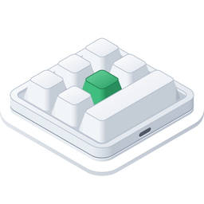

<p align="center"></p>

<h1 align="center">أداة إعداد لوحات مفاتيح الماكرو لنظام Windows</h1>

<p align="center">
  
  
  
  <a href="../LICENSE"></a>
</p>

<p align="center"><a href="../README.md">English</a> · <a href="README.ko.md">한국어</a> · <b>العربية</b> · <a href="README.de.md">Deutsch</a> · <a href="README.es.md">Español</a> · <a href="README.es-419.md">Español (Latinoamérica)</a> · <a href="README.fr.md">Français</a> · <a href="README.id.md">Bahasa Indonesia</a> · <a href="README.it.md">Italiano</a> · <a href="README.ja.md">日本語</a> · <a href="README.pl.md">Polski</a> · <a href="README.pt-BR.md">Português (Brasil)</a> · <a href="README.pt-PT.md">Português (Portugal)</a> · <a href="README.ru.md">Русский</a> · <a href="README.th.md">ไทย</a> · <a href="README.vi.md">Tiếng Việt</a> · <a href="README.zh-Hans.md">简体中文</a> · <a href="README.zh-Hant.md">繁體中文</a></p>

تطبيق لنظام Windows يكتب إعدادات المفاتيح على لوحات مفاتيح الماكرو الصغيرة بمنفذ USB — وهي اللوحات التي تُباع بدءًا من
مقبض واحد فقط وحتى 21 مفتاحًا، وبما يصل إلى أربعة مقابض. ولكل مفتاح ولكل إجراء من إجراءات المقبض (التدوير إلى اليسار،
والضغط، والتدوير إلى اليمين) يضبط التطبيق ضغطات المفاتيح أو مفتاح وسائط أو إجراء ماوس في الطبقات 1–3، ويضبط أيضًا إضاءة
لوحة المفاتيح. وهو نسخة Windows من تطبيق لنظام macOS بُني على القواعد نفسها، ويستخدم الأوامر نفسها.

<p align="center"></p>

| لوحة المفاتيح | التخطيط | قراءة الإعدادات | الانتظار | الإضاءة | جُرّبت فعليًا |
|---|---|---|---|---|---|
| `1189:8890` | تحدده أنت — المفاتيح (حتى 12)، والمفاتيح في كل صف، والمقابض (حتى 2) | لا | لا | ثلاثة أوضاع | نعم — 6 مفاتيح ومقبض واحد |
| الشركة المصنعة `1189` أو `514C`، المنتج `8840` · `8842` · `8830`–`8833` · `8850` · `8851`، ببرنامج ثابت أحدث | وفق ما تذكره لوحة المفاتيح — 26 تخطيطًا | عند التوصيل | قبل كل ضغطة | وضع واحد، ولون لكل مفتاح من المفاتيح 1–16 | نعم — `514C:8850`، 12 مفتاحًا ومقبضان |
| اللوحات نفسها، ببرنامج ثابت أقدم | وفق ما تذكره لوحة المفاتيح | عند التوصيل | انتظار واحد لكل مفتاح | لون ووضع | لا |
| اللوحات نفسها حين لا تذكر نوعها | تختاره أنت — 26 تخطيطًا | لا | لا | لون ووضع | لا |

لوحة المفاتيح `1189:8890` هي اللوحة التي تعمل معها «MINI KeyBoard»، أداة الشركة المصنعة لنظام Windows؛ أما البقية فهي
اللوحات التي يبحث عنها «MINI_KEYBOARD»، تطبيق الشركة المصنعة متعدد المنصات. ويستخدم التطبيق أوامر كلتا الأداتين. ومعظم
لوحات الفئة الثانية تذكر عدد مفاتيحها ومقابضها والبرنامج الثابت الذي تعمل به، فيرسم التطبيق التخطيط الذي كان سيرسمه
تطبيق الشركة المصنعة؛ أما اللوحة التي لا تذكر ذلك فتحصل على التخطيط الذي تختاره أنت من بين تلك التخطيطات. ولا يعرف تطبيق
الشركة المصنعة لوحة `1189:8890`، ولا ترسم أداتها الخاصة أي شكل، لذا فشكلها الحقيقي غير معروف: تُخبر أنت التطبيق بعدد
مفاتيحها ومقابضها وبعدد المفاتيح في كل صف، فيرسمها بترتيب منظم وفق ذلك.

يتوفر التطبيق بـ 18 لغة — الإنجليزية، والكورية، واليابانية، والصينية (المبسطة والتقليدية)، والألمانية، والإسبانية
(إسبانيا وأمريكا اللاتينية)، والفرنسية، والإيطالية، والبرتغالية (البرازيل والبرتغال)، والبولندية، والروسية،
والإندونيسية، والفيتنامية، والتايلاندية، والعربية — ويتبع لغة Windows (أو اللغة التي تختارها في الإعدادات). ويظهر
بالإنجليزية في اللغات الأخرى.

الشيفرة المصدرية في هذا المستودع مرخّصة بترخيص MIT. وبعض أجزاء التطبيق الموزَّع ليست ضمن هذه الشيفرة — اسمه وأيقونته
وروابطه. والأيقونة المعروضة في الأعلى للاطلاع: لا يشملها ترخيص MIT بل ترخيص CC BY-SA 4.0
([`LICENSES/CC-BY-SA-4.0.txt`](../LICENSES/CC-BY-SA-4.0.txt))، ولا تتضمنها البنيات التي تُنشأ من هذا المستودع.

## على macOS وWindows وLinux والويب

يتوفر MINIKeyboard في أربع نسخ مبنية على القواعد نفسها — الأوامر نفسها، واللغات الـ 18 نفسها. وتدعم التطبيقات الثلاثة لوحات المفاتيح نفسها، أما نسخة الويب، التي تعمل في المتصفح، فتدعمها جميعًا ما عدا `1189:8890`.

| المستودع | GitHub |
|---|---|
| **MINIKeyboardApple**<br>    | [github.com/hobbyworker/MINIKeyboardApple](https://github.com/hobbyworker/MINIKeyboardApple) |
| **MINIKeyboardWin**<br>    | [github.com/hobbyworker/MINIKeyboardWin](https://github.com/hobbyworker/MINIKeyboardWin) |
| **MINIKeyboardLinux**<br>    | [github.com/hobbyworker/MINIKeyboardLinux](https://github.com/hobbyworker/MINIKeyboardLinux) |
| **MINIKeyboardWeb**<br>    | [github.com/hobbyworker/MINIKeyboardWeb](https://github.com/hobbyworker/MINIKeyboardWeb) |

## التنزيل

نزّل برنامج التثبيت المناسب لجهازك من صفحة [Releases](https://github.com/hobbyworker/MINIKeyboardWin/releases) وشغّله —
`MINIKeyboard-<version>-x64-Setup.exe` لأجهزة Intel وAMD، و`-arm64-Setup.exe` لأجهزة ARM. يُثبَّت التطبيق في مجلد المستخدم
الخاص بك دون صلاحيات المسؤول، مع اختصارات على سطح المكتب وفي قائمة «ابدأ». ولأن برنامج التثبيت غير موقَّع، يعرض Windows في
المرة الأولى «قام Windows بحماية الكمبيوتر الخاص بك»: اختر **مزيد من المعلومات**، ثم **تشغيل على أي حال**.

يحدّث التطبيق نفسه بنفسه. فهو يبحث عن إصدار جديد عند التشغيل ومرة كل يوم
(**الإعدادات ▸ التطبيق ▸ التحقق من وجود تحديثات تلقائيًا**)، وعندما تختار ⋯ ▸ **التحقق من وجود تحديثات…**. وعند توفر
إصدار جديد، اختر **تحديث وإعادة التشغيل** في الشريط أعلى النافذة. وتبقى إعداداتك كما هي. أما ملفات `.nupkg`
و`releases.*.json` في صفحة Releases فهي ما ينزّله التطبيق ليتحدّث، ولا حاجة لك بها. ولإزالة التطبيق، افتح في Windows
الإعدادات ▸ التطبيقات ▸ التطبيقات المثبتة.

## المتطلبات

- نظام Windows 10 الإصدار 2004 أو أحدث، أو Windows 11، على x64 أو ARM64
- لا حاجة إلى برنامج تشغيل ولا إلى أي إذن: تُفتح لوحات الفئتين كلتيهما كأجهزة HID.
  - تُكتب الإعدادات على لوحة `1189:8890` عبر واجهة التكوين فيها (واجهة USB رقم 1)، كما تفعل أداة الشركة المصنعة. ولا يقرأ
    التطبيق أبدًا ما تكتبه بها.
  - أما اللوحات الأخرى فيُكتب عليها عبر واجهة USB الأولى فيها، كما يفعل تطبيق الشركة المصنعة. وتواصل لوحة المفاتيح
    الكتابة كالمعتاد في أثناء ذلك.

## البناء

يتطلب البناء .NET 10 SDK (الإصدار 10.0.402 أو أحدث) — ولا يلزم Visual Studio. يُبنى التطبيق على Windows فقط؛ أما المكتبات
الثلاث والاختبارات فتُبنى على أي نظام.

```powershell
copy Brand.props.example Brand.props                                 # مرة واحدة — ثم املأ BrandName
dotnet build src/MINIKeyboard/MINIKeyboard.csproj -p:Platform=x64    # على جهاز ARM: -p:Platform=ARM64
dotnet test --project tests/MINIKeyboard.Domain.Tests                # وكذلك Data.Tests وPresentation.Tests — لا تُلمَس أي لوحة مفاتيح
```

يُنشأ التطبيق في `src/MINIKeyboard/bin/<x64 or ARM64>/Debug/net10.0-windows10.0.26100.0/MINIKeyboard.exe`.

اسم التطبيق وأيقونته وروابطه ليست في المستودع — ضع قيمك الخاصة في `Brand.props`. ومن دون اسم (`BrandName`) يتوقف بناء
التطبيق وحده ويطلب اسمًا؛ أما المكتبات والاختبارات فتُبنى كما هي. والأيقونة وسطر حقوق النشر والروابط اختيارية — ومن دون
أيقونة يحصل التطبيق على الأيقونة العامة في Windows.

للبنية ثلاثة أنواع (`-p:Distribution=…`). النوع `Source`، وهو الافتراضي، ليست له تحديثات خاصة به. والنوع `Direct` يُثبَّت
ويُحدَّث بواسطة [Velopack](https://velopack.io): ويحدد `BrandUpdateUrl` مكان الإصدارات الجديدة — مستودع على GitHub (صفحة
Releases فيه)، أو أي عنوان أو مجلد آخر يحتوي على موجز Velopack. أما `Store` فهو المكان المخصص لبنية Microsoft Store، ولم
يجهز بعد.

يتيح لك ⋯ ▸ **المحاكي** تجربة التطبيق دون لوحة المفاتيح المعنية: اختر `1189:8890`، أو تخطيطًا ببرنامج ثابت أحدث، أو لوحة
مفاتيح لا تذكر نوعها، فيتصرف التطبيق كأنها موصولة — بالأوامر نفسها، ودون أن يُرسَل أي شيء عبر USB. وفي أثناء استخدام
إحداها، يشير إلى ذلك شريط برتقالي أعلى النافذة، وللرجوع اختر **العودة إلى لوحة مفاتيح USB**. وتتيح بنيات Debug جميع
الأنواع (معرّفات التقارير الأخرى للوحة `1189:8890`، والبرنامج الثابت الأقدم)، ومع `MINIKEYBOARD_SIMULATED_KEYBOARD`
(`8890-3` مثلًا) يبدأ التطبيق بإحداها. ويعرض ⋯ ▸ **سجل الجهاز** (Ctrl+Alt+L) كل تقرير مكتوب وكل رد.

## الاستخدام

1. وصّل لوحة المفاتيح عبر USB. يعثر عليها التطبيق، ويسأل لوحات الفئة الثانية عن نوعها؛ واللوحة التي تجيب تُقرأ إعداداتها
   فورًا.
2. إذا كانت لوحة المفاتيح لا تذكر شكلها، فسيُطلب منك في المرة الأولى تحديد تخطيطها — أحد تخطيطات تطبيق الشركة المصنعة، أو
   بالنسبة إلى `1189:8890` عدد مفاتيحها والمفاتيح في كل صف ومقابضها — وكيفية وضعها أمامك. ويتذكر التطبيق الأمرين كليهما
   لمعرّف USB هذا. ويمكنك تغييرهما لاحقًا باستخدام **الشكل…** و**تدوير** (Ctrl+T)؛ أما اللوحة التي ذكرت شكلها فيمكن
   تدويرها فقط.
3. اختر طبقة، ثم المفتاح أو إجراء المقبض في رسم لوحة المفاتيح.
4. عيّن له إجراءً:
   - **المفاتيح** — أبقِ مفاتيح التعديل مضغوطة (Ctrl، Alt، Shift، Win، والمفاتيح اليمنى منها أيضًا)، ثم انقر المفاتيح؛ فكل
     نقرة تضيف ضغطة. ويحوّل الخيار **مفاتيح التعديل فقط** المفتاحَ إلى مفتاح تعديل. ويعرض **QWERTY** المفاتيح بترتيب لوحة
     مفاتيح كاملة الحجم، و**ABC** في مجموعات؛ ولا يمكن النقر إلا على المفاتيح التي يمكن تعيينها في لوحة المفاتيح.
   - **الوسائط المتعددة**، **الماوس** — يحل كل منهما محل الإجراء السابق للمفتاح.
   - **LED** — إضاءة الطبقة؛ وفي البرنامج الثابت الأحدث، حدد أحد المفاتيح 1–16 لتعيين لون له.
   - **التأخير** — في البرنامج الثابت الذي يحفظ فترات الانتظار.
5. يكتب الأمر **حفظ** (Ctrl+S) ما تغيّر. ويطلب الأمر **قراءة** (Ctrl+R) من لوحة المفاتيح التي تدعم القراءة ما تحمله من
   إعدادات.

في ⋯ ▸ **الإعدادات** (Ctrl+,) تختار لغة الواجهة (واحدة من اللغات الـ 18، أو لغة Windows) والمظهر الفاتح أو الداكن. وفي
التطبيق المنزَّل من صفحة Releases يوجد هناك أيضًا **التطبيق ▸ التحقق من وجود تحديثات تلقائيًا**. وفي قسم **حول** أسفل الصفحة
تجد الإصدار والروابط و**البرامج المضمّنة** — أي تراخيص ما يأتي مع التطبيق من برامج.

في **الإعدادات ▸ تجاوز أخطاء البرنامج الثابت** يوجد الخيار **منع تكرار المفاتيح بعد تغيير الإضاءة**، وهو مُفعَّل افتراضيًا.
فبعد حفظ الإضاءة، يكرر البرنامج الثابت في `1189:8890` أول ضغطة للمفتاح بلا توقف — ويحدث الأمر نفسه مع برنامج الشركة
المصنعة — لذا يرسل التطبيق بعد الإضاءة أمر حفظ إضافيًا لا يحتوي على أي مفتاح. وعند إيقاف الخيار، يرسل التطبيق ما يرسله
برنامج الشركة المصنعة فقط. كما أن هذه اللوحة تنسى إضاءتها عند فصلها.

## الهيكل

تقع القواعد في ثلاث مكتبات تتجه اعتمادياتها إلى الداخل — والطبقة التي تمتد إلى الخارج لا تجتاز الترجمة البرمجية.

```
src/
├── MINIKeyboard.Domain/        لوحات المفاتيح، والإجراءات، وعناصر التحكم في كل تخطيط، وما يمكن أن تحمله كل لوحة مفاتيح؛ والمنافذ؛ وحالات الاستخدام (مكتبة الفئات الأساسية فقط)
├── MINIKeyboard.Data/          أوامر كل لوحة مفاتيح والأرقام التي تُعرَّف بها عناصر التحكم فيها؛ والعثور عليها والكتابة عبر HID (SetupAPI، hid.dll)؛ ولوحات مفاتيح المحاكي
├── MINIKeyboard.Presentation/  نماذج العرض والقيم التي ترسمها الشاشات — هندسة التخطيطات، وجداول المفاتيح والألوان (دون إطار عمل للواجهة)
├── MINIKeyboard.Views/         WinUI 3 — لا يرى إلا presentation؛ وجدول ترجمة لكل لغة (Translations/)
└── MINIKeyboard/               جذر التركيب (composition root): المشروع الوحيد الذي يرى كل المشاريع. ولا يدخل Direct/ إلا في نسخة التنزيل المباشر (Velopack)
tests/                          xUnit — بايتات كل أمر، والتخطيطات، والتعديلات، والمحرر
Brand.props.example             الاسم والأيقونة والروابط وقيم كل نوع من أنواع البنية — انسخه إلى Brand.props واملأه
LICENSES/                       ترخيص الأيقونة المعروضة في الأعلى (CC BY-SA 4.0)
```

المعيار هو صفر تحذيرات. تُصلَح التحذيرات ولا تُعطَّل.

## القيود

- جُرّبت الكتابة حتى الآن على لوحتي مفاتيح في Windows 11: لوحة `1189:8890` بستة مفاتيح ومقبض واحد، على أجهزة ARM64 وx64
  على حد سواء، ولوحة `514C:8850` باثني عشر مفتاحًا ومقبضين ببرنامج ثابت أحدث، على ARM64. ولم تُجرَّب الكتابة على Windows 10
  بعد. أما لوحات المفاتيح الأخرى فيُكتب عليها كما يكتب عليها تطبيق الشركة المصنعة — والأوامر مطابقة لأوامر تطبيق macOS
  بايتًا بايتًا، وتثبّتها الاختبارات — لكن لم تُجرَّب أي منها بعد.
- لا تستطيع لوحة `1189:8890`، ولا لوحات المفاتيح التي لا تذكر نوعها، الإبلاغ عن إعداداتها، لذا لا يعرض التطبيق إلا ما
  ضُبط فيه.
- تُفتح لوحة مفاتيح واحدة في كل مرة. وعند توصيل عدة لوحات، تختار اللوحة المطلوبة بالزر المجاور لحالة الاتصال؛ ويفتح
  التطبيق اللوحة التي اختيرت في المرة السابقة، وإلا فأول لوحة يعثر عليها، مع تقديم لوحة `1189:8890` على غيرها.
- لا يتوفر تحريك الماوس ولا السحب.

## الترخيص

ترخيص MIT — انظر [LICENSE](../LICENSE). الأيقونة المعروضة في الأعلى: CC BY-SA 4.0 — انظر
[LICENSES/CC-BY-SA-4.0.txt](../LICENSES/CC-BY-SA-4.0.txt).

ويتضمن التطبيق أيضًا مكونات من Microsoft — هي Windows App SDK وWindows SDK for .NET — مرخّصة بموجب شروط Microsoft الخاصة،
لا بترخيص MIT. وتجد هذه الشروط في التطبيق ضمن الإعدادات ▸ حول ▸ **البرامج المضمّنة**، واستخدامك للتطبيق يعني قبولك لها
فيما يخص تلك المكونات.
