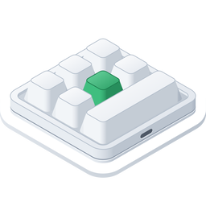

<p align="center"></p>

<h1 align="center">Konfigurator für Makrotastaturen unter Windows</h1>

<p align="center">
  
  
  
  <a href="../LICENSE"></a>
</p>

<p align="center"><a href="../README.md">English</a> · <a href="README.ko.md">한국어</a> · <b>Deutsch</b> · <a href="README.es.md">Español</a> · <a href="README.fr.md">Français</a> · <a href="README.id.md">Bahasa Indonesia</a> · <a href="README.it.md">Italiano</a> · <a href="README.ja.md">日本語</a> · <a href="README.pl.md">Polski</a> · <a href="README.pt-BR.md">Português (Brasil)</a> · <a href="README.vi.md">Tiếng Việt</a> · <a href="README.zh-Hans.md">简体中文</a> · <a href="README.zh-Hant.md">繁體中文</a></p>

Eine Windows-App, die Tastenbelegungen auf kleine USB-Makrotastaturen schreibt – auf die Modelle, die es vom einzelnen
Drehknopf bis zu 21 Tasten und mit bis zu vier Drehknöpfen zu kaufen gibt. Für jede Aktion einer Taste oder eines
Drehknopfs (nach links drehen, drücken, nach rechts drehen) legt sie auf den Ebenen 1–3 Tastendrücke, eine
Multimedia-Taste oder eine Mausaktion fest, außerdem die Beleuchtung der Tastatur. Sie ist das Windows-Gegenstück zu
einer macOS-App, die nach denselben Regeln gebaut ist, und verwendet dieselben Befehle.

<p align="center"></p>

| Tastatur | Anordnung | Auslesen | Verzögerung | Beleuchtung | Getestet |
|---|---|---|---|---|---|
| `1189:8890` | legst du fest – Tasten (bis zu 12), Tasten pro Reihe, Drehknöpfe (bis zu 2) | nein | keine | drei Modi | ja – 6 Tasten und ein Drehknopf |
| Hersteller `1189` oder `514C`, Produkt `8840` · `8842` · `8830`–`8833` · `8850` · `8851`, neuere Firmware | wie die Tastatur sie meldet – 26 Anordnungen | sofort beim Verbinden | vor jedem Tastendruck | ein Modus und eine Farbe für jede der Tasten 1–16 | ja – `514C:8850`, 12 Tasten und 2 Drehknöpfe |
| dieselben, ältere Firmware | wie die Tastatur sie meldet | sofort beim Verbinden | eine pro Taste | eine Farbe und ein Modus | nein |
| dieselben, ohne Angabe ihres Typs | wählst du – 26 Anordnungen | nein | keine | eine Farbe und ein Modus | nein |

Die `1189:8890` ist die Tastatur, mit der das Windows-Tool des Herstellers, „MINI KeyBoard“, arbeitet; die übrigen
sind die, nach denen die plattformübergreifende App des Herstellers, „MINI_KEYBOARD“, sucht. Die App verwendet die
Befehle beider Tools. Die meisten Tastaturen der zweiten Art melden, wie viele Tasten und Drehknöpfe sie haben und
welche Firmware darauf läuft – dann zeichnet die App die Anordnung so, wie die App des Herstellers sie zeichnen würde.
Eine Tastatur, die das nicht meldet, bekommt die Anordnung, die du unter diesen auswählst. Die App des Herstellers
kennt die `1189:8890` nicht, und ihr eigenes Tool zeichnet keine Form, daher ist ihre tatsächliche Form unbekannt: Du
gibst an, wie viele Tasten und Drehknöpfe sie hat und wie viele Tasten in einer Reihe liegen, und die App zeichnet
daraus eine ordentliche Anordnung.

Die App gibt es in 13 Sprachen – Englisch, Koreanisch, Japanisch, Chinesisch (vereinfacht und traditionell), Deutsch,
Spanisch, Französisch, Italienisch, Portugiesisch (Brasilien), Polnisch, Indonesisch und Vietnamesisch. Sie folgt der
Sprache von Windows (oder der, die du in den Einstellungen wählst); in allen anderen Sprachen erscheint sie auf
Englisch.

Der Quellcode in diesem Repository steht unter der MIT-Lizenz. Einige Teile der veröffentlichten App – ihr Name, ihr
Symbol und ihre Links – sind nicht in diesem Quellcode enthalten. Das Symbol ganz oben dient nur der Anschauung: Es
fällt nicht unter die MIT-Lizenz, sondern unter CC BY-SA 4.0 ([`LICENSES/CC-BY-SA-4.0.txt`](../LICENSES/CC-BY-SA-4.0.txt)),
und Builds aus diesem Repository enthalten es nicht.

## macOS, Windows und Linux

MINIKeyboard gibt es in drei Ausgaben nach denselben Regeln – dieselben Tastaturen, dieselben Befehle, dieselben 13 Sprachen.

| Repository | GitHub |
|---|---|
| **MINIKeyboardApple**<br>    | [github.com/hobbyworker/MINIKeyboardApple](https://github.com/hobbyworker/MINIKeyboardApple) |
| **MINIKeyboardWin**<br>    | [github.com/hobbyworker/MINIKeyboardWin](https://github.com/hobbyworker/MINIKeyboardWin) |
| **MINIKeyboardLinux**<br>    | [github.com/hobbyworker/MINIKeyboardLinux](https://github.com/hobbyworker/MINIKeyboardLinux) |

## Herunterladen

Lade unter [Releases](https://github.com/hobbyworker/MINIKeyboardWin/releases) das Installationsprogramm für deinen PC
herunter und führe es aus – `MINIKeyboard-<Version>-x64-Setup.exe` für Intel und AMD, `-arm64-Setup.exe` für ARM. Es
installiert die App ohne Administratorrechte in deinen Benutzerordner und legt Verknüpfungen auf dem Desktop und im
Startmenü an. Das Installationsprogramm ist nicht signiert, daher zeigt Windows beim ersten Mal „Der Computer wurde
durch Windows geschützt“: Wähle **Weitere Informationen** und dann **Trotzdem ausführen**.

Die App aktualisiert sich selbst. Sie sucht beim Start und einmal am Tag nach einer neuen Version
(**Einstellungen ▸ App ▸ Automatisch nach Updates suchen**) sowie dann, wenn du ⋯ ▸ **Nach Updates suchen…** wählst.
Gibt es eine, wähle in der Leiste oben im Fenster **Aktualisieren und neu starten**. Deine Einstellungen bleiben
erhalten. Die Dateien `.nupkg` und `releases.*.json` unter Releases lädt die App für ihre Updates herunter; du brauchst
sie nicht. Zum Entfernen der App öffne in Windows Einstellungen ▸ Apps ▸ Installierte Apps.

## Voraussetzungen

- Windows 10 ab Version 2004 oder Windows 11, auf x64 oder ARM64
- Weder Treiber noch Berechtigung nötig: Beide Arten werden als HID-Geräte geöffnet.
  - Auf die `1189:8890` wird wie im Tool des Herstellers über ihre Konfigurationsschnittstelle (USB-Schnittstelle 1)
    geschrieben. Die App liest nie mit, was du tippst.
  - Die übrigen Tastaturen werden wie in der App des Herstellers über ihre erste USB-Schnittstelle beschrieben. Die
    Tastatur tippt währenddessen ganz normal weiter.

## Build

Nötig ist das .NET 10 SDK (10.0.402 oder neuer) – Visual Studio braucht es nicht. Die App lässt sich nur unter Windows
bauen, die drei Bibliotheken und die Tests auf jedem System.

```powershell
copy Brand.props.example Brand.props                                 # einmalig – danach BrandName eintragen
dotnet build src/MINIKeyboard/MINIKeyboard.csproj -p:Platform=x64    # auf einem ARM-PC -p:Platform=ARM64
dotnet test --project tests/MINIKeyboard.Domain.Tests                # ebenso Data.Tests und Presentation.Tests – keine Tastatur wird angerührt
```

Die fertige App liegt unter `src/MINIKeyboard/bin/<x64 oder ARM64>/Debug/net10.0-windows10.0.26100.0/MINIKeyboard.exe`.

Name, Symbol und Links der App liegen nicht im Repository – trage deine eigenen in `Brand.props` ein. Ohne Namen
(`BrandName`) bricht nur der Build der App ab und verlangt einen; die Bibliotheken und Tests lassen sich so bauen, wie
sie sind. Symbol, Copyright-Zeile und Links sind optional – ohne Symbol bekommt die App das allgemeine Symbol von
Windows.

Es gibt drei Arten von Builds (`-p:Distribution=…`). `Source`, der Standard, hat keine eigenen Updates. `Direct` wird
mit [Velopack](https://velopack.io) installiert und aktualisiert: `BrandUpdateUrl` gibt an, wo die neuen Versionen
liegen – ein GitHub-Repository (dessen Releases) oder eine beliebige andere Adresse oder ein Ordner mit dem Feed von
Velopack. `Store` ist für einen Build für den Microsoft Store vorgesehen, der noch nicht fertig ist.

Mit ⋯ ▸ **Simulator** kannst du die App ohne die betreffende Tastatur ausprobieren: Wähle eine `1189:8890`, eine
Anordnung auf der neueren Firmware oder eine Tastatur, die ihren Typ nicht angibt – dann verhält sich die App, als wäre
sie angeschlossen, mit denselben Befehlen, nur dass nichts über USB hinausgeht. Solange eine simulierte Tastatur aktiv
ist, sagt das ein orangefarbener Balken oben im Fenster, und **Zurück zur Tastatur am USB** kehrt zurück. Debug-Builds
bieten jede Art an (die anderen Report-IDs der `1189:8890`, die ältere Firmware), und mit
`MINIKEYBOARD_SIMULATED_KEYBOARD` (zum Beispiel `8890-3`) startet die App gleich mit einer davon.
⋯ ▸ **Geräteprotokoll** (Ctrl+Alt+L) zeigt jeden geschriebenen Report und jede Antwort.

## Verwendung

1. Schließe die Tastatur über USB an. Die App findet sie und fragt eine Tastatur der zweiten Art nach ihrem Typ; eine,
   die antwortet, wird sofort ausgelesen.
2. Bei einer Tastatur, die ihre Form nicht angibt, legst du beim ersten Mal die Anordnung fest – eine der Anordnungen
   aus der App des Herstellers, bei der `1189:8890` die Zahl der Tasten, der Tasten pro Reihe und der Drehknöpfe – und
   wie sie vor dir liegt. Die App merkt sich beides für diese USB-ID. Später änderst du das mit **Form…** und
   **Drehen** (Ctrl+T); eine Tastatur, die ihre Form angegeben hat, lässt sich nur drehen.
3. Wähle eine Ebene und dann auf der Tastatur die Taste oder die Drehknopf-Aktion.
4. Gib ihr eine Aktion:
   - **Tasten** – Halte Sondertasten gedrückt (Ctrl, Alt, Shift, Win und die rechten), dann klicke auf Tasten; jeder
     Klick fügt einen Tastendruck hinzu. **Nur Sondertasten** macht die Taste zur Sondertaste. **QWERTY** ordnet die
     Tasten wie auf einer Tastatur in voller Größe an, **ABC** in Gruppen; anklicken lassen sich nur Tasten, die die
     Tastatur annimmt.
   - **Multimedia**, **Maus** – ersetzen, was die Taste vorher tat.
   - **LED** – die Beleuchtung der Ebene; bei neuerer Firmware wählst du eine der Tasten 1–16 aus, um ihr eine Farbe
     zu geben.
   - **Verzögerung** – bei Firmware, die Wartezeiten speichert.
5. **Sichern** (Ctrl+S) schreibt, was sich geändert hat. **Lesen** (Ctrl+R) holt bei einer Tastatur, die sich auslesen
   lässt, die aktuellen Einstellungen.

Unter ⋯ ▸ **Einstellungen** (Ctrl+,) wählst du die Sprache der Oberfläche (eine der 13 oder die von Windows) und Hell
oder Dunkel. Bei der App aus Releases findest du dort außerdem **App ▸ Automatisch nach Updates suchen**. Unter
**Über** ganz unten stehen die Version, die Links und **Enthaltene Software** – die Lizenzen der Software, die mit der
App ausgeliefert wird.

**Tastenwiederholung nach dem Ändern der Beleuchtung verhindern** (**Einstellungen ▸ Firmware-Fehler umgehen**) ist
standardmäßig aktiviert. Die Firmware der `1189:8890` wiederholt nach dem Sichern der Beleuchtung das erste Zeichen
einer Taste endlos – die Software des Herstellers verhält sich genauso –, darum sendet die App nach der Beleuchtung
noch einen Sicherungsbefehl ohne Taste. Ist die Option deaktiviert, sendet die App nur das, was auch die Software des
Herstellers sendet. Diese Tastatur vergisst ihre Beleuchtung außerdem, wenn man sie absteckt.

## Aufbau

Die Regeln stecken in drei Bibliotheken, deren Abhängigkeiten nur nach innen zeigen – eine Schicht, die nach außen
greift, lässt sich nicht kompilieren.

```
src/
├── MINIKeyboard.Domain/        Tastaturen, Aktionen, die Bedienelemente jeder Anordnung und was jede Tastatur aufnehmen kann; die Ports; Use Cases (nur die Basisklassenbibliothek)
├── MINIKeyboard.Data/          die Befehle jeder Tastatur und die Nummern ihrer Bedienelemente; Tastatur finden und über HID schreiben (SetupAPI, hid.dll); simulierte Tastaturen
├── MINIKeyboard.Presentation/  View-Models und die Werte, die die Ansichten zeichnen – die Geometrie der Anordnungen, Tasten- und Farbtabellen (kein UI-Framework)
├── MINIKeyboard.Views/         WinUI 3 – sieht nur Presentation; eine Übersetzungstabelle pro Sprache (Translations/)
└── MINIKeyboard/               die Composition Root – das einzige Projekt, das alle kennt. Direct/ kommt nur in den direkten Download (Velopack)
tests/                          xUnit – die Bytes jedes Befehls, die Anordnungen, die Bearbeitungen, der Editor
Brand.props.example             Name, Symbol, Links und die Werte jedes Builds – nach Brand.props kopieren und ausfüllen
LICENSES/                       die Lizenz des Symbols ganz oben (CC BY-SA 4.0)
```

Null Warnungen ist der Maßstab. Warnungen werden behoben, nicht abgeschaltet.

## Einschränkungen

- Geschrieben wurde bisher nur auf eine einzige Tastatur, eine `1189:8890` mit sechs Tasten und einem Drehknopf, unter
  Windows 11, auf ARM64- wie auf x64-PCs. Unter Windows 10 wurde das noch nicht ausprobiert. Die übrigen Tastaturen
  werden so beschrieben, wie die App ihres Herstellers sie beschreibt – die Befehle sind bis aufs Byte die der
  macOS-App, und Tests halten sie fest –, aber an einer echten Tastatur wurde noch keine davon ausprobiert.
- Die `1189:8890` und Tastaturen, die ihren Typ nicht angeben, können ihre Einstellungen nicht melden; die App zeigt
  daher nur, was in ihr festgelegt wurde.
- Immer nur eine Tastatur. Sind mehrere angeschlossen, nimmt die App die erste, die sie findet – eine `1189:8890`
  zuerst.
- Mausbewegungen und Ziehen werden nicht angeboten.

## Lizenz

MIT – siehe [LICENSE](../LICENSE). Das Symbol ganz oben: CC BY-SA 4.0 – siehe
[LICENSES/CC-BY-SA-4.0.txt](../LICENSES/CC-BY-SA-4.0.txt).

Die App enthält außerdem Komponenten von Microsoft – das Windows App SDK und das Windows SDK for .NET –, die nicht
unter MIT, sondern unter den eigenen Bedingungen von Microsoft stehen. Diese Bedingungen findest du in der App unter
Einstellungen ▸ Über ▸ **Enthaltene Software**; wer die App verwendet, akzeptiert sie für diese Komponenten.
