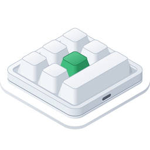
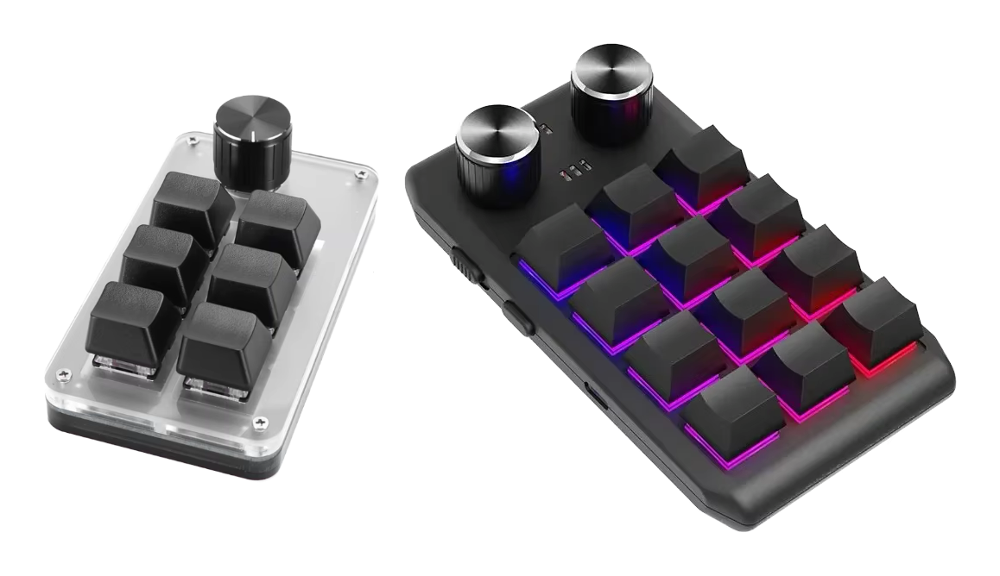

<p align="center"></p>

<h1 align="center">Configurador de teclados de macros para Windows</h1>

<p align="center">
  
  
  
  <a href="../LICENSE"></a>
</p>

<p align="center"><a href="../README.md">English</a> · <a href="README.ko.md">한국어</a> · <a href="README.de.md">Deutsch</a> · <a href="README.es.md">Español</a> · <a href="README.fr.md">Français</a> · <a href="README.id.md">Bahasa Indonesia</a> · <a href="README.it.md">Italiano</a> · <a href="README.ja.md">日本語</a> · <a href="README.pl.md">Polski</a> · <a href="README.pt-BR.md">Português (Brasil)</a> · <b>Português (Portugal)</b> · <a href="README.vi.md">Tiếng Việt</a> · <a href="README.zh-Hans.md">简体中文</a> · <a href="README.zh-Hant.md">繁體中文</a></p>

Uma app para Windows que escreve as definições das teclas em pequenos teclados de macros USB. São vendidos em vários
tamanhos: desde os que têm só um botão rotativo até aos de 21 teclas, com até quatro botões rotativos. Para cada
tecla e cada ação de botão rotativo (rodar para a esquerda, premir, rodar para a direita), a app define nas
camadas 1–3 toques de teclas, uma tecla multimédia ou uma ação do rato, além da iluminação do teclado. É a versão
para Windows de uma app para macOS feita com as mesmas regras, e utiliza os mesmos comandos.

<p align="center"></p>

| Teclado | Disposição | Leitura | Atraso | Iluminação | Testado |
|---|---|---|---|---|---|
| `1189:8890` | definida por si — teclas (até 12), teclas por fila, botões rotativos (até 2) | não | não | três modos | sim — 6 teclas e um botão rotativo |
| fabricante `1189` ou `514C`, produto `8840` · `8842` · `8830`–`8833` · `8850` · `8851`, firmware novo | conforme o que o teclado indica — 26 disposições | ao ligar | antes de cada toque | um modo e uma cor para cada uma das teclas 1–16 | sim — `514C:8850`, 12 teclas e 2 botões rotativos |
| os mesmos, firmware antigo | conforme o que o teclado indica | ao ligar | um por tecla | uma cor e um modo | não |
| os mesmos, sem indicar o tipo | escolhida por si — 26 disposições | não | não | uma cor e um modo | não |

O `1189:8890` é o teclado com que trabalha a ferramenta de configuração para Windows do fabricante, “MINI KeyBoard”;
os restantes são os que a app multiplataforma do fabricante, “MINI_KEYBOARD”, procura. A app utiliza os comandos das
duas ferramentas. A maioria dos teclados do segundo tipo indica quantas teclas e botões rotativos tem e que firmware
utiliza, por isso a app desenha a mesma disposição que a app do fabricante desenharia; para um teclado que não o
indica, utiliza a disposição que escolher entre essas. A app do fabricante não conhece o `1189:8890`, e a própria
ferramenta deste não desenha nenhuma forma, por isso não se sabe qual é a forma real. Assim, indica quantas teclas e
botões rotativos tem e quantas teclas há em cada fila, e a app desenha tudo isso de forma organizada.

A app está disponível em 14 idiomas — inglês, coreano, japonês, chinês (simplificado e tradicional), alemão,
espanhol, francês, italiano, português (Brasil e Portugal), polaco, indonésio e vietnamita — e segue o idioma do
Windows (ou o que escolher em Definições). Em qualquer outro idioma, aparece em inglês.

O código-fonte deste repositório está sob a licença MIT. Algumas partes da app distribuída — o nome, o ícone e os
links — não fazem parte deste código. O ícone no topo é mostrado apenas como referência: não está abrangido pela
licença MIT, mas sim pela CC BY-SA 4.0 ([`LICENSES/CC-BY-SA-4.0.txt`](../LICENSES/CC-BY-SA-4.0.txt)), e as
compilações deste repositório não o incluem.

## macOS, Windows, Linux e a web

O MINIKeyboard tem quatro edições feitas com as mesmas regras — os mesmos comandos, os mesmos 14 idiomas. As três apps aceitam os mesmos teclados, e a edição web, que funciona no navegador, todos menos o `1189:8890`.

| Repositório | GitHub |
|---|---|
| **MINIKeyboardApple**<br>    | [github.com/hobbyworker/MINIKeyboardApple](https://github.com/hobbyworker/MINIKeyboardApple) |
| **MINIKeyboardWin**<br>    | [github.com/hobbyworker/MINIKeyboardWin](https://github.com/hobbyworker/MINIKeyboardWin) |
| **MINIKeyboardLinux**<br>    | [github.com/hobbyworker/MINIKeyboardLinux](https://github.com/hobbyworker/MINIKeyboardLinux) |
| **MINIKeyboardWeb**<br>    | [github.com/hobbyworker/MINIKeyboardWeb](https://github.com/hobbyworker/MINIKeyboardWeb) |

## Transferir

Transfira o instalador adequado ao seu PC na página [Releases](https://github.com/hobbyworker/MINIKeyboardWin/releases)
e execute-o: `MINIKeyboard-<versão>-x64-Setup.exe` para Intel e AMD, e `-arm64-Setup.exe` para ARM. É instalado na
pasta de utilizador, sem direitos de administrador, com atalhos no ambiente de trabalho e no menu Iniciar. O
instalador não está assinado, por isso, na primeira vez, o Windows mostra “O Windows protegeu o seu PC”: escolha
**Mais informações** e depois **Executar mesmo assim**.

A app atualiza-se sozinha. Procura uma versão nova ao iniciar e uma vez por dia (**Definições ▸ App ▸ Procurar
atualizações automaticamente**), e também quando escolhe ⋯ ▸ **Procurar atualizações…**. Quando houver uma,
escolha **Atualizar e reabrir** na barra no topo da janela. As suas definições mantêm-se. Os ficheiros `.nupkg` e
`releases.*.json` da página Releases são o que a app transfere para se atualizar; não precisa deles. Para remover a
app, vá a Definições ▸ Aplicações ▸ Aplicações instaladas, no Windows.

## Requisitos

- Windows 10 versão 2004 ou posterior, ou Windows 11, em x64 ou ARM64
- Não é preciso nenhum controlador nem nenhuma permissão: os dois tipos são abertos como dispositivos HID.
  - No `1189:8890`, a app escreve pela interface de configuração dele (interface USB 1), como faz a ferramenta do
    fabricante. A app nunca lê o que escreve ao teclado.
  - Nos restantes teclados, a app escreve pela primeira interface USB, como faz a app do fabricante. Entretanto,
    pode continuar a escrever normalmente com o teclado.

## Compilação

É preciso o SDK do .NET 10 (10.0.402 ou posterior) — o Visual Studio não é necessário. A app só é compilada no
Windows; as três bibliotecas e os testes compilam-se em qualquer sistema.

```powershell
copy Brand.props.example Brand.props                                 # uma vez — depois, preencha BrandName
dotnet build src/MINIKeyboard/MINIKeyboard.csproj -p:Platform=x64    # num PC ARM, -p:Platform=ARM64
dotnet test --project tests/MINIKeyboard.Domain.Tests                # e Data.Tests, Presentation.Tests — não toca em nenhum teclado
```

A app fica em `src/MINIKeyboard/bin/<x64 ou ARM64>/Debug/net10.0-windows10.0.26100.0/MINIKeyboard.exe`.

O nome, o ícone e os links da app não estão no repositório — coloque os seus em `Brand.props`. Sem um nome
(`BrandName`), só a app para e pede um; as bibliotecas e os testes compilam-se normalmente. O ícone, a linha de
copyright e os links são opcionais — sem ícone, a app usa o ícone genérico do Windows.

Cada compilação é de um de três tipos (`-p:Distribution=…`). `Source`, a predefinição, não tem atualizações próprias.
`Direct` é instalada e atualizada pelo [Velopack](https://velopack.io): `BrandUpdateUrl` indica onde estão as versões
novas — um repositório do GitHub (os respetivos Releases) ou qualquer outro endereço ou pasta que tenha o feed do
Velopack. `Store` é o lugar reservado a uma compilação para a Microsoft Store, que ainda não está pronta.

⋯ ▸ **Simulador** permite experimentar a app sem o teclado em questão: escolha um `1189:8890`, uma disposição do
firmware novo ou um teclado que não indique o tipo, e a app age como se estivesse ligado — com os mesmos comandos,
sem enviar nada por USB. Enquanto estiver em utilização, uma barra laranja no topo da janela avisa, e
**Voltar ao teclado ligado por USB** volta ao teclado real. As compilações Debug oferecem todos os tipos (os outros
IDs do relatório do `1189:8890`, o firmware antigo) e, com `MINIKEYBOARD_SIMULATED_KEYBOARD` (por exemplo, `8890-3`),
a app inicia logo com esse teclado. ⋯ ▸ **Registo do dispositivo** (Ctrl+Alt+L) mostra todos os relatórios escritos
e todas as respostas.

## Como utilizar

1. Ligue o teclado por USB. A app encontra-o e, se for do segundo tipo, pergunta-lhe que teclado é; se ele
   responder, lê-o de imediato.
2. Na primeira vez, para um teclado que não indica a forma, define a disposição — uma das disposições da app do
   fabricante ou, no `1189:8890`, o número de teclas, de teclas por fila e de botões rotativos — e a posição em que
   fica à sua frente. A app guarda as duas coisas para esse ID USB. Depois, pode alterá-las com **Forma…** e
   **Rodar** (Ctrl+T). Um teclado que indicou a forma só pode ser rodado.
3. Escolha uma camada e, no desenho do teclado, uma tecla ou uma ação de botão rotativo.
4. Atribua uma ação:
   - **Teclas** — mantenha premidas as teclas modificadoras (Ctrl, Alt, Shift, Win e as do lado direito) e clique
     nas teclas; cada clique adiciona um toque. **Só modificadoras** transforma a tecla numa tecla modificadora.
     **QWERTY** dispõe as teclas como num teclado completo e **ABC**, em grupos. Só é possível clicar nas teclas que
     o teclado aceita.
   - **Multimédia**, **Rato** — substituem o que a tecla fazia.
   - **LED** — a iluminação da camada. No firmware novo, escolha uma das teclas 1–16 para lhe dar uma cor.
   - **Atraso** — no firmware que guarda os atrasos.
5. **Guardar** (Ctrl+S) escreve o que mudou. **Ler** (Ctrl+R) obtém a configuração atual dos teclados que permitem a
   leitura.

Em ⋯ ▸ **Definições** (Ctrl+,), escolhe o idioma da interface (um dos 14 ou o do Windows) e tons claros ou escuros.
A app da página Releases também tem aí **App ▸ Procurar atualizações automaticamente**. Em **Informações**, no fim,
vê a versão, os links e **Software incluído** — as licenças do software que acompanha a app.

Em **Definições ▸ Contornar erros do firmware**, **Evitar a repetição de teclas após alterar a iluminação** vem
ativado por predefinição. O firmware do `1189:8890` repete sem parar o primeiro carácter de uma tecla depois de a
iluminação ser guardada (o software do fabricante faz o mesmo), por isso a app envia mais um comando de guardar, sem
nenhuma tecla, depois da iluminação. Desativado, a app envia apenas o mesmo que o software do fabricante. Este
teclado também se esquece da iluminação quando é desligado.

## Estrutura

As regras ficam em três bibliotecas cujas dependências apontam só para dentro: uma camada que tente alcançar algo de
fora não compila.

```
src/
├── MINIKeyboard.Domain/        teclados, ações, os controlos de cada disposição e o que cada teclado comporta; as portas; casos de utilização (só a biblioteca de classes base)
├── MINIKeyboard.Data/          os comandos de cada teclado e a numeração dos controlos; encontrar o teclado e escrever por HID (SetupAPI, hid.dll); teclados simulados
├── MINIKeyboard.Presentation/  view models e os valores que os ecrãs desenham — a geometria das disposições, tabelas de teclas e cores (sem framework de UI)
├── MINIKeyboard.Views/         WinUI 3 — só vê Presentation; uma tabela de tradução por idioma (Translations/)
└── MINIKeyboard/               a composition root: o único projeto que conhece todos os outros. Direct/ só entra na transferência direta (Velopack)
tests/                          xUnit — os bytes de cada comando, as disposições, as edições, o editor
Brand.props.example             o nome, o ícone, os links e os valores de cada tipo de compilação — copie para Brand.props e preencha
LICENSES/                       a licença do ícone no topo (CC BY-SA 4.0)
```

Zero avisos é a regra. Os avisos corrigem-se, não se desativam.

## Limitações

- Até agora, a escrita foi testada em dois teclados, no Windows 11: um `1189:8890` com seis teclas e um botão
  rotativo, em PCs ARM64 e x64, e um `514C:8850` com doze teclas e dois botões rotativos, com firmware novo, em
  ARM64. Ainda não foi testada no Windows 10. Os restantes teclados são escritos como a app do fabricante os
  escreve — os comandos são os da app para macOS, byte a byte, e os testes fixam-nos —, mas nenhum deles foi ainda
  testado num teclado real.
- O `1189:8890` e os teclados que não indicam o tipo não conseguem indicar a configuração atual, por isso a app mostra
  só o que foi definido nela.
- Um teclado aberto de cada vez. Com vários ligados, o botão ao lado do estado da ligação escolhe qual; a app abre o
  escolhido da última vez ou, se não houver, o primeiro que encontrar — um `1189:8890` primeiro.
- Não há ações para mover o rato nem para arrastar.

## Licença

MIT — consulte [LICENSE](../LICENSE). O ícone no topo: CC BY-SA 4.0 — consulte
[LICENSES/CC-BY-SA-4.0.txt](../LICENSES/CC-BY-SA-4.0.txt).

A app também inclui componentes da Microsoft — o Windows App SDK e o Windows SDK for .NET — que não estão sob a MIT,
mas sim sob os termos da própria Microsoft. Esses termos estão na app, em Definições ▸ Informações ▸
**Software incluído**, e utilizar a app significa aceitá-los para esses componentes.
