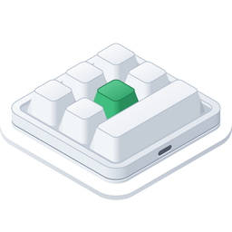

<p align="center"></p>

<h1 align="center">Конфигуратор макроклавиатур для Windows</h1>

<p align="center">
  
  
  
  <a href="../LICENSE"></a>
</p>

<p align="center"><a href="../README.md">English</a> · <a href="README.ko.md">한국어</a> · <a href="README.de.md">Deutsch</a> · <a href="README.es.md">Español</a> · <a href="README.fr.md">Français</a> · <a href="README.id.md">Bahasa Indonesia</a> · <a href="README.it.md">Italiano</a> · <a href="README.ja.md">日本語</a> · <a href="README.pl.md">Polski</a> · <a href="README.pt-BR.md">Português (Brasil)</a> · <a href="README.pt-PT.md">Português (Portugal)</a> · <b>Русский</b> · <a href="README.th.md">ไทย</a> · <a href="README.vi.md">Tiếng Việt</a> · <a href="README.zh-Hans.md">简体中文</a> · <a href="README.zh-Hant.md">繁體中文</a></p>

Приложение для Windows, которое записывает настройки клавиш в маленькие USB-макроклавиатуры. Такие клавиатуры
продаются в самых разных вариантах — от одной-единственной ручки до 21 клавиши, а ручек у них бывает до четырёх. Для
каждой клавиши и каждого действия ручки (поворот влево, нажатие, поворот вправо) приложение задаёт на слоях 1–3
нажатия клавиш, медиаклавишу или действие мыши, а также подсветку клавиатуры. Это Windows-версия приложения для macOS,
созданного по тем же правилам, и команды у неё те же.

<p align="center"></p>

| Клавиатура | Компоновка | Считывание | Задержки | Подсветка | Проверено |
|---|---|---|---|---|---|
| `1189:8890` | задаёте вы — клавиши (до 12), клавиш в ряду, ручки (до 2) | нет | нет | три режима | да — 6 клавиш и ручка |
| производитель `1189` или `514C`, продукт `8840` · `8842` · `8830`–`8833` · `8850` · `8851`, новая прошивка | по данным клавиатуры — 26 компоновок | сразу при подключении | перед каждым нажатием | режим и цвет для каждой из клавиш 1–16 | да — `514C:8850`, 12 клавиш и 2 ручки |
| те же, старая прошивка | по данным клавиатуры | сразу при подключении | одна на клавишу | цвет и режим | нет |
| те же, не сообщающие свой тип | выбираете вы — 26 компоновок | нет | нет | цвет и режим | нет |

Клавиатура `1189:8890` — та, с которой работает утилита производителя для Windows «MINI KeyBoard»; остальные — те,
которые ищет кроссплатформенное приложение производителя «MINI_KEYBOARD». Приложение использует команды обоих
инструментов. Большинство клавиатур второго вида сообщают, сколько у них клавиш и ручек и какая у них прошивка,
и приложение рисует ту же компоновку, что нарисовало бы приложение производителя; для клавиатуры, которая этого не
сообщает, используется выбранная вами компоновка из их числа. Приложение производителя не знает `1189:8890`,
а собственная утилита этой клавиатуры не рисует никакой формы, поэтому её настоящая форма неизвестна: вы указываете,
сколько у неё клавиш и ручек и сколько клавиш в ряду, а приложение аккуратно рисует именно такое расположение.

Приложение доступно на 16 языках — английском, корейском, японском, китайском (упрощённом и традиционном), немецком,
испанском, французском, итальянском, португальском (Бразилия и Португалия), польском, русском, индонезийском,
вьетнамском и тайском — и следует языку Windows (или тому, который вы выберете в настройках). Для остальных языков
используется английский.

Исходный код в этом репозитории распространяется по лицензии MIT. Некоторые части распространяемого приложения — его
название, значок и ссылки — в этот код не входят. Значок вверху показан для наглядности: на него распространяется не
лицензия MIT, а CC BY-SA 4.0 ([`LICENSES/CC-BY-SA-4.0.txt`](../LICENSES/CC-BY-SA-4.0.txt)), и в сборки из этого
репозитория он не входит.

## macOS, Windows, Linux и веб

MINIKeyboard выходит в четырёх версиях, созданных по одним и тем же правилам, — те же команды, те же 16 языков. Три приложения поддерживают одни и те же клавиатуры, а веб-версия, работающая в браузере, — все, кроме `1189:8890`.

| Репозиторий | GitHub |
|---|---|
| **MINIKeyboardApple**<br>    | [github.com/hobbyworker/MINIKeyboardApple](https://github.com/hobbyworker/MINIKeyboardApple) |
| **MINIKeyboardWin**<br>    | [github.com/hobbyworker/MINIKeyboardWin](https://github.com/hobbyworker/MINIKeyboardWin) |
| **MINIKeyboardLinux**<br>    | [github.com/hobbyworker/MINIKeyboardLinux](https://github.com/hobbyworker/MINIKeyboardLinux) |
| **MINIKeyboardWeb**<br>    | [github.com/hobbyworker/MINIKeyboardWeb](https://github.com/hobbyworker/MINIKeyboardWeb) |

## Загрузка

Скачайте установщик для своего компьютера со страницы
[Releases](https://github.com/hobbyworker/MINIKeyboardWin/releases) и запустите его —
`MINIKeyboard-<версия>-x64-Setup.exe` для Intel и AMD, `-arm64-Setup.exe` для ARM. Приложение устанавливается в папку
пользователя без прав администратора, а ярлыки появляются на рабочем столе и в меню «Пуск». Установщик не подписан,
поэтому при первом запуске Windows показывает «Система Windows защитила ваш компьютер»: выберите **Подробнее**,
а затем **Выполнить в любом случае**.

Приложение обновляется само. Оно ищет новую версию при запуске и раз в день
(**Настройки ▸ Приложение ▸ Автоматически проверять наличие обновлений**), а также когда вы выбираете
⋯ ▸ **Проверить наличие обновлений…**. Если новая версия есть, выберите **Обновить и перезапустить** на полосе вверху
окна. Ваши настройки сохраняются. Файлы `.nupkg` и `releases.*.json` на странице Releases приложение скачивает для
обновления; вам они не нужны. Чтобы удалить приложение, откройте в Windows Параметры ▸ Приложения ▸ Установленные
приложения.

## Требования

- Windows 10 версии 2004 или новее либо Windows 11, на x64 или ARM64
- Не нужны ни драйвер, ни разрешения: клавиатуры обоих видов открываются как HID-устройства.
  - Клавиатура `1189:8890` записывается через свой интерфейс настройки (USB-интерфейс 1), как это делает утилита
    производителя. Приложение никогда не читает то, что вы набираете.
  - Остальные записываются через свой первый USB-интерфейс, как это делает приложение производителя. Клавиатура при
    этом продолжает печатать как обычно.

## Сборка

Нужен .NET 10 SDK (10.0.402 или новее) — Visual Studio не требуется. Само приложение собирается только в Windows,
а три библиотеки и тесты — в любой системе.

```powershell
copy Brand.props.example Brand.props                                 # один раз — затем укажите BrandName
dotnet build src/MINIKeyboard/MINIKeyboard.csproj -p:Platform=x64    # на компьютере с ARM: -p:Platform=ARM64
dotnet test --project tests/MINIKeyboard.Domain.Tests                # а также Data.Tests, Presentation.Tests — клавиатуры не затрагиваются
```

Собранное приложение находится
в `src/MINIKeyboard/bin/<x64 или ARM64>/Debug/net10.0-windows10.0.26100.0/MINIKeyboard.exe`.

Названия, значка и ссылок приложения в репозитории нет — укажите свои в `Brand.props`. Без названия (`BrandName`)
только сборка приложения останавливается и просит его указать; библиотеки и тесты собираются как есть. Значок, строка
об авторских правах и ссылки необязательны — без значка у приложения будет стандартный значок Windows.

Сборка бывает одного из трёх видов (`-p:Distribution=…`). `Source`, вариант по умолчанию, не имеет собственных
обновлений. `Direct` устанавливается и обновляется с помощью [Velopack](https://velopack.io): `BrandUpdateUrl`
указывает, где лежат новые версии, — репозиторий GitHub (его Releases) или любой другой адрес или папка с каналом
Velopack. `Store` — заготовка для сборки под Microsoft Store, она пока не готова.

⋯ ▸ **Симулятор** позволяет попробовать приложение без самой клавиатуры: выберите `1189:8890`, компоновку на новой
прошивке или клавиатуру, которая не сообщает свой тип, и приложение будет вести себя так, будто она подключена, —
с теми же командами, но ничего не отправляя по USB. Пока симулятор используется, об этом сообщает оранжевая полоса
вверху окна, а **Вернуться к USB-клавиатуре** возвращает к настоящей клавиатуре. В сборках Debug доступны все варианты
(другие ID отчёта `1189:8890`, старая прошивка), а с `MINIKEYBOARD_SIMULATED_KEYBOARD` (например, `8890-3`) приложение
сразу запускается с одним из них. ⋯ ▸ **Журнал устройства** (Ctrl+Alt+L) показывает все записанные отчёты и все
ответы.

## Использование

1. Подключите клавиатуру по USB. Приложение находит её, а у клавиатуры второго вида запрашивает тип; если клавиатура
   отвечает, её настройки сразу считываются.
2. Если клавиатура не сообщает свою форму, в первый раз приложение просит выбрать компоновку — одну из компоновок
   приложения производителя, а для `1189:8890` число клавиш, клавиш в ряду и ручек — и то, как клавиатура лежит перед
   вами. Приложение запоминает и то и другое для этого USB ID. Позже их можно изменить командами **Форма…**
   и **Повернуть** (Ctrl+T); клавиатуру, которая сообщила свою форму, можно только поворачивать.
3. Выберите слой, а затем на изображении клавиатуры — клавишу или действие ручки.
4. Назначьте действие:
   - **Клавиши** — удерживайте модификаторы (Ctrl, Alt, Shift, Win, а также правые) и щёлкайте по клавишам; каждый
     щелчок добавляет нажатие. **Только модификаторы** превращает клавишу в клавишу-модификатор. **QWERTY**
     располагает клавиши как на полноразмерной клавиатуре, **ABC** — группами; щёлкнуть можно только по тем клавишам,
     которые принимает клавиатура.
   - **Мультимедиа**, **Мышь** — заменяют прежнее действие клавиши.
   - **LED** — подсветка слоя; на новой прошивке выберите одну из клавиш 1–16, чтобы задать ей цвет.
   - **Задержка** — на прошивке, которая хранит задержки.
5. **Сохранить** (Ctrl+S) записывает изменения. **Считать** (Ctrl+R) получает текущие настройки с клавиатуры, которая
   поддерживает считывание.

⋯ ▸ **Настройки** (Ctrl+,) позволяют выбрать язык интерфейса (один из 16 или язык Windows) и светлое или тёмное
оформление. В приложении, скачанном со страницы Releases, там есть
и **Приложение ▸ Автоматически проверять наличие обновлений**. Раздел **О приложении** внизу содержит версию, ссылки
и **Входящее в комплект ПО** — лицензии того, что поставляется вместе с приложением.

В разделе **Настройки ▸ Обход ошибок прошивки** параметр **Предотвращать повтор клавиш после изменения подсветки**
по умолчанию включён. После сохранения подсветки прошивка `1189:8890` бесконечно повторяет первый символ клавиши —
с программой производителя происходит то же самое, — поэтому после подсветки приложение отправляет ещё одну команду
сохранения, без клавиш. Если параметр выключен, приложение отправляет только то же, что и программа производителя.
Кроме того, эта клавиатура забывает подсветку, когда её отключают.

## Структура

Правила находятся в трёх библиотеках, зависимости которых направлены только внутрь, — слой, который тянется наружу, не
компилируется.

```
src/
├── MINIKeyboard.Domain/        клавиатуры, действия, элементы управления каждой компоновки и то, что может хранить каждая клавиатура; порты; сценарии использования (только библиотека базовых классов)
├── MINIKeyboard.Data/          команды каждой клавиатуры и нумерация её элементов управления; поиск клавиатуры и запись через HID (SetupAPI, hid.dll); клавиатуры симулятора
├── MINIKeyboard.Presentation/  модели представления и значения, которые рисуют экраны, — геометрия компоновок, таблицы клавиш и цветов (без UI-фреймворка)
├── MINIKeyboard.Views/         WinUI 3 — видит только presentation; таблица переводов для каждого языка (Translations/)
└── MINIKeyboard/               composition root: единственный проект, который видит все остальные. Direct/ входит только в версию для прямой загрузки (Velopack)
tests/                          xUnit — байты каждой команды, компоновки, правки, редактор
Brand.props.example             название, значок, ссылки и значения для каждого вида сборки — скопируйте в Brand.props и заполните
LICENSES/                       лицензия значка вверху (CC BY-SA 4.0)
```

Ноль предупреждений — обязательное требование. Предупреждения исправляют, а не отключают.

## Ограничения

- Запись пока проверена в Windows 11 на двух клавиатурах: `1189:8890` с шестью клавишами и ручкой — на компьютерах
  с ARM64 и x64 — и `514C:8850` с двенадцатью клавишами и двумя ручками на новой прошивке — на ARM64. В Windows 10
  запись ещё не проверялась. Остальные клавиатуры записываются так же, как их записывает приложение производителя, —
  команды байт в байт совпадают с командами приложения для macOS, и тесты это фиксируют, — но ни одну из этих
  клавиатур ещё не проверяли на реальном устройстве.
- Клавиатура `1189:8890` и те, что не сообщают свой тип, не могут передать свои настройки, поэтому приложение
  показывает только то, что было задано в нём самом.
- Одновременно открыта только одна клавиатура. Если подключено несколько, нужную выбирают кнопкой рядом с состоянием
  подключения; приложение открывает ту, что была выбрана в прошлый раз, а если такой нет — первую найденную, причём
  сначала `1189:8890`.
- Перемещения мыши и перетаскивания нет.

## Лицензия

MIT — см. [LICENSE](../LICENSE). Значок вверху: CC BY-SA 4.0 — см.
[LICENSES/CC-BY-SA-4.0.txt](../LICENSES/CC-BY-SA-4.0.txt).

Приложение также содержит компоненты Microsoft — Windows App SDK и Windows SDK for .NET, — на которые распространяется
не лицензия MIT, а собственные условия Microsoft. Эти условия приведены в приложении в разделе
Настройки ▸ О приложении ▸ **Входящее в комплект ПО**, и, используя приложение, вы принимаете их в отношении этих
компонентов.
