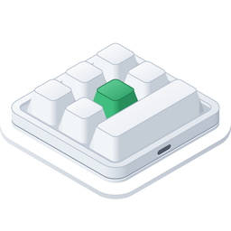

<p align="center"></p>

<h1 align="center">เครื่องมือตั้งค่าแป้นพิมพ์มาโครสำหรับ Windows</h1>

<p align="center">
  
  
  
  <a href="../LICENSE"></a>
</p>

<p align="center"><a href="../README.md">English</a> · <a href="README.ko.md">한국어</a> · <a href="README.ar.md">العربية</a> · <a href="README.de.md">Deutsch</a> · <a href="README.es.md">Español</a> · <a href="README.es-419.md">Español (Latinoamérica)</a> · <a href="README.fr.md">Français</a> · <a href="README.id.md">Bahasa Indonesia</a> · <a href="README.it.md">Italiano</a> · <a href="README.ja.md">日本語</a> · <a href="README.pl.md">Polski</a> · <a href="README.pt-BR.md">Português (Brasil)</a> · <a href="README.pt-PT.md">Português (Portugal)</a> · <a href="README.ru.md">Русский</a> · <b>ไทย</b> · <a href="README.vi.md">Tiếng Việt</a> · <a href="README.zh-Hans.md">简体中文</a> · <a href="README.zh-Hant.md">繁體中文</a></p>

แอป Windows ที่เขียนการตั้งค่าปุ่มลงในแป้นพิมพ์มาโคร USB ขนาดเล็ก — แบบที่วางขายตั้งแต่รุ่นที่มีปุ่มหมุนเพียงปุ่มเดียวไปจนถึงรุ่นที่มีปุ่ม 21 ปุ่ม และมีปุ่มหมุนได้สูงสุดสี่ปุ่ม สำหรับปุ่มแต่ละปุ่มและการทำงานแต่ละแบบของปุ่มหมุน (หมุนซ้าย, กด, หมุนขวา) แอปจะกำหนดการกดปุ่ม ปุ่มสื่อ หรือการทำงานของเมาส์ในเลเยอร์ 1–3 และตั้งค่าแสงไฟของแป้นพิมพ์ได้ด้วย แอปนี้เป็นรุ่น Windows ของแอป macOS ที่สร้างตามกฎเดียวกัน และใช้คำสั่งเดียวกัน

<p align="center"></p>

| แป้นพิมพ์ | เลย์เอาต์ | อ่านค่ากลับ | หน่วงเวลา | แสงไฟ | ทดสอบกับเครื่องจริง |
|---|---|---|---|---|---|
| `1189:8890` | คุณจัดเอง — ปุ่ม (สูงสุด 12), ปุ่มต่อแถว, ปุ่มหมุน (สูงสุด 2) | ไม่ได้ | ไม่มี | สามโหมด | ทดสอบแล้ว — ปุ่ม 6 ปุ่มและปุ่มหมุน 1 ปุ่ม |
| ผู้ผลิต `1189` หรือ `514C`, ผลิตภัณฑ์ `8840` · `8842` · `8830`–`8833` · `8850` · `8851`, เฟิร์มแวร์รุ่นใหม่ | ตามที่แป้นพิมพ์แจ้ง — 26 เลย์เอาต์ | ทันทีที่เชื่อมต่อ | ก่อนการกดแต่ละครั้ง | หนึ่งโหมด และสีของปุ่ม 1–16 แต่ละปุ่ม | ทดสอบแล้ว — `514C:8850`, ปุ่ม 12 ปุ่มและปุ่มหมุน 2 ปุ่ม |
| แป้นพิมพ์กลุ่มเดียวกัน, เฟิร์มแวร์รุ่นเก่า | ตามที่แป้นพิมพ์แจ้ง | ทันทีที่เชื่อมต่อ | ปุ่มละหนึ่งค่า | สีและโหมด | ยังไม่ได้ทดสอบ |
| แป้นพิมพ์กลุ่มเดียวกันที่ไม่บอกประเภท | คุณเลือกเอง — 26 เลย์เอาต์ | ไม่ได้ | ไม่มี | สีและโหมด | ยังไม่ได้ทดสอบ |

`1189:8890` คือแป้นพิมพ์ที่เครื่องมือตั้งค่าบน Windows ของผู้ผลิต “MINI KeyBoard” รองรับ ส่วนแป้นพิมพ์อื่นคือแป้นพิมพ์ที่แอปข้ามแพลตฟอร์มของผู้ผลิต “MINI_KEYBOARD” ค้นหา แอปนี้ใช้คำสั่งของเครื่องมือทั้งสอง แป้นพิมพ์กลุ่มที่สองส่วนใหญ่จะบอกว่ามีปุ่มและปุ่มหมุนกี่ปุ่ม และใช้เฟิร์มแวร์แบบใด แอปจึงวาดเลย์เอาต์แบบเดียวกับที่แอปของผู้ผลิตวาด ส่วนแป้นพิมพ์ที่ไม่บอกจะใช้เลย์เอาต์ที่คุณเลือกจากเลย์เอาต์เหล่านั้น แอปของผู้ผลิตไม่รู้จัก `1189:8890` และเครื่องมือของแป้นพิมพ์นี้เองก็ไม่ได้วาดรูปทรงไว้ จึงไม่ทราบรูปทรงจริงของแป้นพิมพ์ เพียงบอกแอปว่ามีปุ่มและปุ่มหมุนกี่ปุ่ม และแถวหนึ่งมีกี่ปุ่ม แอปก็จะวาดให้เป็นระเบียบตามนั้น

แอปมีให้ใช้ 18 ภาษา ได้แก่ อังกฤษ เกาหลี ญี่ปุ่น จีน (ตัวย่อและตัวเต็ม) เยอรมัน สเปน (สเปนและละตินอเมริกา) ฝรั่งเศส อิตาลี โปรตุเกส (บราซิลและโปรตุเกส) โปแลนด์ รัสเซีย อินโดนีเซีย เวียดนาม ไทย และอาหรับ โดยจะแสดงตามภาษาของ Windows (หรือภาษาที่คุณเลือกในการตั้งค่า) ส่วนภาษาอื่นจะแสดงเป็นภาษาอังกฤษ

ซอร์สโค้ดในที่เก็บนี้ใช้สัญญาอนุญาต MIT บางส่วนของแอปที่เผยแพร่ไม่ได้อยู่ในซอร์สนี้ ได้แก่ ชื่อ ไอคอน และลิงก์ของแอป ไอคอนด้านบนแสดงไว้เพื่ออ้างอิง ไม่อยู่ภายใต้สัญญาอนุญาต MIT แต่อยู่ภายใต้ CC BY-SA 4.0 ([`LICENSES/CC-BY-SA-4.0.txt`](../LICENSES/CC-BY-SA-4.0.txt)) และบิลด์จากที่เก็บนี้ไม่มีไอคอนนี้

## macOS, Windows, Linux และเว็บ

MINIKeyboard มีสี่รุ่นที่สร้างตามกฎเดียวกัน — ใช้คำสั่งเดียวกันและมี 18 ภาษาเหมือนกัน แอปทั้งสามรองรับแป้นพิมพ์ชุดเดียวกัน ส่วนรุ่นเว็บซึ่งทำงานในเบราว์เซอร์รองรับแป้นพิมพ์ทั้งหมดนั้นยกเว้น `1189:8890`

| ที่เก็บ | GitHub |
|---|---|
| **MINIKeyboardApple**<br>    | [github.com/hobbyworker/MINIKeyboardApple](https://github.com/hobbyworker/MINIKeyboardApple) |
| **MINIKeyboardWin**<br>    | [github.com/hobbyworker/MINIKeyboardWin](https://github.com/hobbyworker/MINIKeyboardWin) |
| **MINIKeyboardLinux**<br>    | [github.com/hobbyworker/MINIKeyboardLinux](https://github.com/hobbyworker/MINIKeyboardLinux) |
| **MINIKeyboardWeb**<br>    | [github.com/hobbyworker/MINIKeyboardWeb](https://github.com/hobbyworker/MINIKeyboardWeb) |

## ดาวน์โหลด

ดาวน์โหลดตัวติดตั้งที่ตรงกับพีซีของคุณจากหน้า [Releases](https://github.com/hobbyworker/MINIKeyboardWin/releases) แล้วเรียกใช้ — `MINIKeyboard-<เวอร์ชั่น>-x64-Setup.exe` สำหรับ Intel และ AMD, `-arm64-Setup.exe` สำหรับ ARM ตัวติดตั้งจะติดตั้งแอปลงในโฟลเดอร์ผู้ใช้ของคุณโดยไม่ต้องใช้สิทธิ์ผู้ดูแลระบบ พร้อมสร้างทางลัดบนเดสก์ท็อปและในเมนูเริ่ม ตัวติดตั้งไม่ได้ลงนาม ครั้งแรกที่เรียกใช้ Windows จึงแสดง “Windows ได้ป้องกันพีซีของคุณ” ให้เลือก **ข้อมูลเพิ่มเติม** แล้วเลือก **เรียกใช้ต่อไป**

แอปอัปเดตตัวเองได้ โดยจะหาเวอร์ชั่นใหม่ตอนเปิดแอปและวันละครั้ง (**การตั้งค่า ▸ แอป ▸ ตรวจหารายการอัปเดตโดยอัตโนมัติ**) และเมื่อคุณเลือก ⋯ ▸ **ตรวจหารายการอัปเดต…** หากมีเวอร์ชั่นใหม่ ให้เลือก **อัปเดตและเปิดใหม่** ในแถบที่ด้านบนของหน้าต่าง การตั้งค่าของคุณจะยังอยู่เหมือนเดิม ไฟล์ `.nupkg` และ `releases.*.json` ในหน้า Releases คือไฟล์ที่แอปดาวน์โหลดไปใช้อัปเดต คุณไม่จำเป็นต้องใช้ไฟล์เหล่านี้ ถ้าต้องการลบแอป ให้ใช้ “การตั้งค่า ▸ แอป ▸ แอปที่ติดตั้ง” ของ Windows

## ข้อกำหนด

- Windows 10 เวอร์ชั่น 2004 ขึ้นไป หรือ Windows 11 บน x64 หรือ ARM64
- ไม่ต้องใช้ไดรเวอร์และไม่ต้องขอสิทธิ์ แอปเปิดแป้นพิมพ์ทั้งสองกลุ่มในฐานะอุปกรณ์ HID
  - แอปเขียนลง `1189:8890` ผ่านช่องทางการตั้งค่า (อินเทอร์เฟซ USB 1) เช่นเดียวกับเครื่องมือของผู้ผลิต แอปไม่อ่านสิ่งที่คุณพิมพ์เลย
  - สำหรับแป้นพิมพ์อื่น แอปเขียนผ่านอินเทอร์เฟซ USB ตัวแรก เช่นเดียวกับแอปของผู้ผลิต ระหว่างนั้นแป้นพิมพ์ยังพิมพ์ได้ตามปกติ

## การบิลด์

ต้องใช้ .NET 10 SDK (10.0.402 ขึ้นไป) — ไม่จำเป็นต้องมี Visual Studio แอปบิลด์ได้บน Windows เท่านั้น ส่วนไลบรารีทั้งสามและการทดสอบบิลด์ได้ทุกที่

```powershell
copy Brand.props.example Brand.props                                 # ครั้งเดียว — แล้วกรอก BrandName
dotnet build src/MINIKeyboard/MINIKeyboard.csproj -p:Platform=x64    # บนพีซี ARM ใช้ -p:Platform=ARM64
dotnet test --project tests/MINIKeyboard.Domain.Tests                # รวมถึง Data.Tests, Presentation.Tests — ไม่แตะแป้นพิมพ์
```

แอปที่บิลด์แล้วจะอยู่ที่ `src/MINIKeyboard/bin/<x64 หรือ ARM64>/Debug/net10.0-windows10.0.26100.0/MINIKeyboard.exe`

ชื่อ ไอคอน และลิงก์ของแอปไม่ได้อยู่ในที่เก็บ — ให้ใส่ของคุณเองใน `Brand.props` ถ้าไม่มีชื่อ (`BrandName`) จะมีเพียงแอปที่หยุดและขอชื่อ ส่วนไลบรารีและการทดสอบยังบิลด์ได้ตามปกติ ไอคอน บรรทัดลิขสิทธิ์ และลิงก์จะใส่หรือไม่ก็ได้ — ถ้าไม่มีไอคอน แอปจะใช้ไอคอนทั่วไปของ Windows

บิลด์มีสามแบบ (`-p:Distribution=…`) แบบเริ่มต้นคือ `Source` ซึ่งไม่มีการอัปเดตในตัว `Direct` ติดตั้งและอัปเดตด้วย [Velopack](https://velopack.io) โดย `BrandUpdateUrl` ระบุว่าเวอร์ชั่นใหม่อยู่ที่ใด — ที่เก็บบน GitHub (หน้า Releases ของที่เก็บนั้น) หรือที่อยู่หรือโฟลเดอร์อื่นใดที่มีฟีดของ Velopack ส่วน `Store` เป็นที่สำหรับบิลด์ Microsoft Store ซึ่งยังไม่พร้อม

⋯ ▸ **โปรแกรมจำลอง** ช่วยให้ลองใช้แอปได้โดยไม่ต้องมีแป้นพิมพ์รุ่นนั้น เลือก `1189:8890`, เลย์เอาต์ของเฟิร์มแวร์รุ่นใหม่ หรือแป้นพิมพ์ที่ไม่บอกประเภท แล้วแอปจะทำงานเหมือนมีแป้นพิมพ์เสียบอยู่ — ด้วยคำสั่งเดียวกัน โดยไม่มีอะไรส่งออกไปทาง USB ระหว่างใช้งาน แถบสีส้มที่ด้านบนของหน้าต่างจะแจ้งให้ทราบ และ **กลับไปใช้แป้นพิมพ์ที่เชื่อมต่อผ่าน USB** จะพากลับมา บิลด์ Debug มีให้เลือกทุกแบบ (Report ID อื่นของ `1189:8890` และเฟิร์มแวร์รุ่นเก่า) และ `MINIKEYBOARD_SIMULATED_KEYBOARD` (เช่น `8890-3`) จะเริ่มแอปด้วยแป้นพิมพ์จำลองตัวนั้น ⋯ ▸ **ประวัติอุปกรณ์** (Ctrl+Alt+L) แสดงรีพอร์ตทุกรายการที่เขียนไปและคำตอบทุกรายการ

## วิธีใช้

1. เชื่อมต่อแป้นพิมพ์ผ่าน USB แอปจะค้นหาแป้นพิมพ์ และถามประเภทจากแป้นพิมพ์กลุ่มที่สอง ถ้าแป้นพิมพ์ตอบ แอปจะอ่านค่าทันที
2. แป้นพิมพ์ที่ไม่บอกรูปทรงจะให้เลือกเลย์เอาต์ในครั้งแรก — หนึ่งในเลย์เอาต์ของแอปผู้ผลิต หรือสำหรับ `1189:8890` คือจำนวนปุ่ม, ปุ่มต่อแถว และปุ่มหมุน — รวมถึงทิศทางที่แป้นพิมพ์วางอยู่ตรงหน้าคุณ แอปจะจำทั้งสองอย่างไว้ตาม USB ID นั้น เปลี่ยนภายหลังได้ด้วย **รูปทรง…** และ **หมุน** (Ctrl+T) ส่วนแป้นพิมพ์ที่บอกรูปทรงแล้วจะหมุนได้อย่างเดียว
3. เลือกเลเยอร์ แล้วเลือกปุ่มหรือการทำงานของปุ่มหมุนบนภาพแป้นพิมพ์
4. กำหนดการทำงาน:
   - **ปุ่ม** — กดปุ่มปรับค่าค้างไว้ (Ctrl, Alt, Shift, Win และปุ่มทางด้านขวา) แล้วคลิกปุ่ม การคลิกแต่ละครั้งจะเพิ่มการกดหนึ่งครั้ง **ปุ่มปรับค่าเท่านั้น** ทำให้ปุ่มนั้นกลายเป็นปุ่มปรับค่า **QWERTY** เรียงปุ่มแบบแป้นพิมพ์ขนาดเต็ม ส่วน **ABC** เรียงเป็นกลุ่ม คลิกได้เฉพาะปุ่มที่แป้นพิมพ์รองรับ
   - **มัลติมีเดีย**, **เมาส์** — แทนที่สิ่งที่ปุ่มเคยทำ
   - **LED** — แสงไฟของเลเยอร์ ในเฟิร์มแวร์รุ่นใหม่ ให้เลือกปุ่มใดปุ่มหนึ่งจากปุ่ม 1–16 เพื่อกำหนดสีให้ปุ่มนั้น
   - **หน่วงเวลา** — สำหรับเฟิร์มแวร์ที่เก็บค่าหน่วงเวลาได้
5. **บันทึก** (Ctrl+S) จะเขียนสิ่งที่เปลี่ยนแปลง **อ่าน** (Ctrl+R) จะดึงการตั้งค่าปัจจุบันจากแป้นพิมพ์ที่อ่านค่าได้

⋯ ▸ **การตั้งค่า** (Ctrl+,) ใช้เลือกภาษาที่แอปแสดง (หนึ่งใน 18 ภาษา หรือภาษาของ Windows) และรูปแบบสว่างหรือมืด แอปจากหน้า Releases ยังมี **แอป ▸ ตรวจหารายการอัปเดตโดยอัตโนมัติ** อยู่ในนั้นด้วย **เกี่ยวกับ** ที่ด้านล่างสุดแสดงเวอร์ชั่น ลิงก์ และ **ซอฟต์แวร์ที่รวมมาด้วย** — สัญญาอนุญาตของซอฟต์แวร์ที่มาพร้อมกับแอป

ใน **การตั้งค่า ▸ วิธีเลี่ยงข้อบกพร่องของเฟิร์มแวร์** มี **ป้องกันการกดปุ่มซ้ำหลังเปลี่ยนแสงไฟ** ซึ่งเปิดไว้เป็นค่าเริ่มต้น หลังบันทึกแสงไฟ เฟิร์มแวร์ของ `1189:8890` จะพิมพ์อักขระแรกของปุ่มซ้ำไม่หยุด — ซอฟต์แวร์ของผู้ผลิตก็เป็นเช่นนี้ — แอปจึงส่งคำสั่งบันทึกอีกหนึ่งครั้งหลังแสงไฟ โดยไม่มีปุ่มใดอยู่ในนั้น เมื่อปิด แอปจะส่งเฉพาะสิ่งที่ซอฟต์แวร์ของผู้ผลิตส่ง นอกจากนี้ แป้นพิมพ์นี้ยังลืมการตั้งค่าแสงไฟเมื่อถอดออกด้วย

## โครงสร้าง

กฎทั้งหมดอยู่ในไลบรารีสามตัวที่การพึ่งพาชี้เข้าด้านในเท่านั้น — เลเยอร์ที่เอื้อมออกไปด้านนอกจะคอมไพล์ไม่ผ่าน

```
src/
├── MINIKeyboard.Domain/        แป้นพิมพ์, การทำงาน, ตัวควบคุมของแต่ละเลย์เอาต์ และสิ่งที่แต่ละแป้นพิมพ์เก็บได้; port; use case (base class library ของ .NET เท่านั้น)
├── MINIKeyboard.Data/          คำสั่งของแต่ละแป้นพิมพ์และหมายเลขที่ตัวควบคุมใช้; การค้นหาแป้นพิมพ์และการเขียนผ่าน HID (SetupAPI, hid.dll); แป้นพิมพ์จำลอง
├── MINIKeyboard.Presentation/  view model และค่าที่หน้าจอวาด — รูปทรงเรขาคณิตของเลย์เอาต์, ตารางปุ่มและสี (ไม่มีเฟรมเวิร์ก UI)
├── MINIKeyboard.Views/         WinUI 3 — เห็นเฉพาะ presentation; ตารางคำแปลของแต่ละภาษา (Translations/)
└── MINIKeyboard/               composition root: โปรเจกต์เดียวที่เห็นทุกส่วน Direct/ รวมอยู่เฉพาะในบิลด์สำหรับดาวน์โหลดโดยตรง (Velopack)
tests/                          xUnit — ไบต์ของทุกคำสั่ง, เลย์เอาต์, การแก้ไข, ตัวแก้ไข
Brand.props.example             ชื่อ, ไอคอน, ลิงก์ และค่าของแต่ละบิลด์ — คัดลอกเป็น Brand.props แล้วกรอก
LICENSES/                       สัญญาอนุญาตของไอคอนด้านบน (CC BY-SA 4.0)
```

เกณฑ์คือไม่มีคำเตือนเลย คำเตือนต้องแก้ ไม่ใช่ปิดไว้

## ข้อจำกัด

- จนถึงตอนนี้ได้ทดสอบการเขียนกับแป้นพิมพ์ 2 ตัวบน Windows 11 ตัวแรกคือ `1189:8890` ที่มีปุ่ม 6 ปุ่มและปุ่มหมุน 1 ปุ่ม บนพีซีทั้ง ARM64 และ x64 อีกตัวคือ `514C:8850` ที่มีปุ่ม 12 ปุ่มและปุ่มหมุน 2 ปุ่ม บนเฟิร์มแวร์รุ่นใหม่ บน ARM64 และยังไม่ได้ทดสอบบน Windows 10 ส่วนแป้นพิมพ์อื่น แอปจะเขียนแบบเดียวกับที่แอปของผู้ผลิตเขียน — คำสั่งตรงกับของแอป macOS ทุกไบต์ และมีการทดสอบยืนยันไว้ — แต่ยังไม่ได้ทดสอบกับแป้นพิมพ์จริงเลยสักตัว
- `1189:8890` และแป้นพิมพ์ที่ไม่บอกประเภทไม่สามารถแจ้งการตั้งค่าปัจจุบันได้ แอปจึงแสดงเฉพาะสิ่งที่ตั้งไว้ในแอป
- เปิดแป้นพิมพ์ได้ทีละตัว ถ้าเสียบไว้หลายตัว ให้เลือกด้วยปุ่มข้างสถานะการเชื่อมต่อ แอปจะเปิดตัวที่เลือกไว้ครั้งก่อน หรือถ้าไม่มี ก็จะเปิดตัวแรกที่พบ โดย `1189:8890` มาก่อน
- ไม่รองรับการเลื่อนเมาส์และการลาก

## สัญญาอนุญาต

MIT — ดู [LICENSE](../LICENSE) ไอคอนด้านบน: CC BY-SA 4.0 — ดู [LICENSES/CC-BY-SA-4.0.txt](../LICENSES/CC-BY-SA-4.0.txt)

แอปยังมีคอมโพเนนต์ของ Microsoft — Windows App SDK และ Windows SDK for .NET — ซึ่งอยู่ภายใต้ข้อกำหนดของ Microsoft เอง ไม่ใช่ MIT ข้อกำหนดเหล่านั้นอยู่ในแอปที่ การตั้งค่า ▸ เกี่ยวกับ ▸ **ซอฟต์แวร์ที่รวมมาด้วย** และการใช้แอปถือว่ายอมรับข้อกำหนดเหล่านั้นสำหรับคอมโพเนนต์ดังกล่าว
